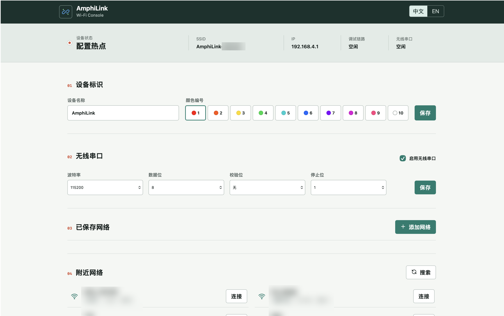
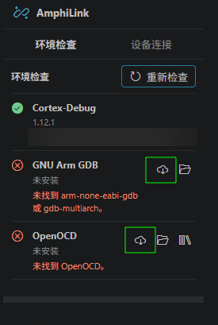
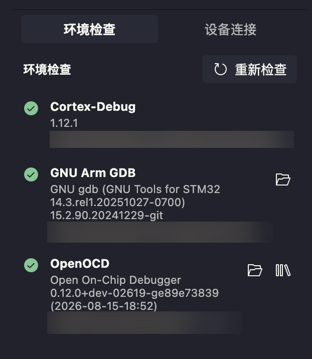
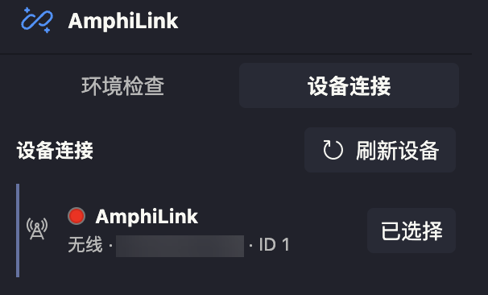
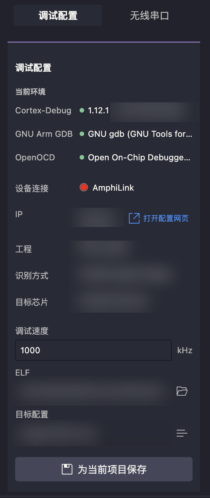
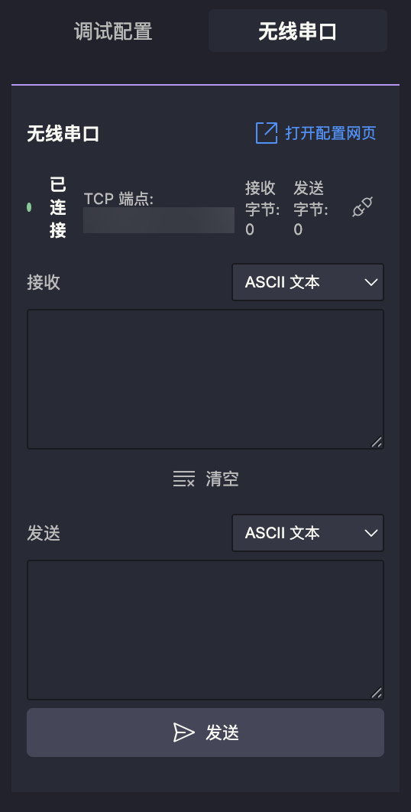

# AmphiLink: A Dual-Mode Wired/Wireless Debugger

[中文](#简介) | [English](#introduction)

## 简介

AmphiLink是一款基于ESP32-S3的双模式CMSIS-DAP V2调试器，支持通过原生USB进行有线调试，也支持通过Wi-Fi和TCP进行无线调试（支持通过较新版本OpenOCD原生TCP协议驱动，电脑端无需额外硬件）。目前项目提供SWD调试，可使用常见的ESP32-S3 N16R8开发板快速搭建。

## 特点

- 简单的硬件：一块常见的ESP32-S3 N16R8开发板
- 方便的连接：电脑上无需连接额外的硬件
- 较高调试速率：核心程序采用直接访问寄存器写法以支持更快的调试速率
- 完整的配套软件：使用配套的VS Code扩展AmphiLink CFG Tool可快速方便地使用本调试器
- OpenOCD原生指令支持：支持OpenOCD原生CMSIS-DAP相关指令，包括其较新版本中的TCP指令
- 独立无线串口：Wi-Fi连接后提供原始UART-over-TCP通道
## 如何使用

### 硬件准备

完全可以使用一块常见且便于购买的成品ESP32-S3 N16R8开发板当作应用本项目的主要硬件，如果希望自制硬件可参考 [硬件设计说明](#硬件设计说明)。

**需要注意的是：如果需要使用无线模式，请确保您的硬件上有板载2.4 GHz天线或者连接了外置2.4 GHz天线，否则可能引起芯片或模组发烫。如果您的硬件没有合适的天线，建议您仔细阅读下文中模式选择部分，否则可能因误操作而损坏芯片。**

1. 程序烧录

   本工程是标准的ESP-IDF工程，可以使用ESP-IDF工具构建或烧录。当然，也可根据Release中的指南直接烧录已经构建好的固件。

2. 参照下表完成主要的SWD调试引脚和无线串口引脚（如需）连接

   | AmphiLink引脚 | 目标设备引脚 | 说明 |
   | --- | --- | --- |
   | GPIO4 | SWCLK | SWD时钟 |
   | GPIO5 | SWDIO | SWD双向数据 |
   | GPIO6 | nRESET | 可选的目标复位信号 |
   | GPIO16 | UART RX | 无线串口接收，连接目标设备 TX |
   | GPIO17 | UART TX | 无线串口发送，连接目标设备 RX |
   | GND | GND | 必须共地 |

   调试信号使用3.3 V逻辑电平。

3. 模式选择

   程序默认会在复位后读取GPIO7的电平，高电平进入无线模式，低电平进入有线模式。模式选择只会在复位后进行一次，若欲切换模式，请改变GPIO7的电平后进行复位操作。

   您也可以通过更改本项目中[transport_path_config.h](components/APP/amphilink/transport_manager/private/transport_path_config.h)中宏DAP_PATH_SELECTION_MODE来进入不同的模式选择方式，具体说明如下：

   | 宏取值 | 模式说明 |
   | --- | --- |
   | `DAP_PATH_MODE_THREE_STATE` | 通过GPIO7上的三档模拟电平选择有线、自动或无线模式；三档分别对应低于825 mV、825-2475 mV和不低于2475 mV |
   | `DAP_PATH_MODE_TWO_STATE` | 通过GPIO7的数字电平选择模式；低电平为有线模式，高电平为无线模式（默认） |
   | `DAP_PATH_MODE_FORCE_WIRED` | 忽略GPIO7，始终使用有线模式 |
   | `DAP_PATH_MODE_FORCE_WIRELESS` | 忽略GPIO7，始终使用无线模式 |
   | `DAP_PATH_MODE_FORCE_AUTO` | 忽略GPIO7，始终使用自动模式 |

   对于自动模式，程序默认先尝试进入无线模式，若失败则退回有线模式，您也可以通过更改[transport_path_config.h](components/APP/amphilink/transport_manager/private/transport_path_config.h)中宏DAP_PATH_AUTO_PREFER_WIRELESS来更改优先顺序

   仅在无线模式下可以使用无线串口功能。

   **如果您使用的硬件没有合适的天线，请确保其不会进入无线模式，否则可能会引起芯片或模组发烫甚至损坏。建议始终保持GPIO7低电平（默认情况下）以免某些情况下（如一些特定方式烧录完成后）自动复位后选择并进入了错误的模式。**

4. 如果希望使用其他自定义的引脚，可以通过更改[bsp_pin_config.h](components/BSP/inc/bsp_pin_config.h)来完成。

### 连接

1. 若使用有线模式

   使用一根USB将本调试器的USB口与电脑的USB口连接（**请注意需要连接ESP32-S3原生的USB口，而非串口转USB口**）

   当前固件枚举为CMSIS-DAP V2 Vendor设备，USB VID为`0x303A`、PID为`0x83B3`，产品字符串为`AmphiLink (CMSIS-DAP V2)`，序列号为ESP32-S3基础MAC地址对应的12位大写十六进制字符串。Windows下固件通过Microsoft OS 2.0描述符自动绑定WinUSB。

2. 若使用无线模式

   需要将本调试器连接到和您用于调试的电脑同一局域网的Wi-Fi下。

   当本调试器无法连接任何已知的网络或没有已知的网络时，其会发出一个名为`AmphiLink-XXXXXX`的热点，其中`XXXXXX`为SoftAP MAC地址末3字节对应的6位大写十六进制字符串。通过密码（默认`12345678`，可参考[管理员密码例子](components/APP/amphilink/tcp/inc/wireless_secrets_example.h)进行更改）连接，然后访问[192.168.4.1](http://192.168.4.1)并通过管理密码（同热点密码）进入配置网页。

   

   在该网页中可配置该调试器的名称和颜色ID（用于辨识），配置后调试器上的WS2812会显示对应的颜色（如有），同时可将该调试器连接到局域网Wi-Fi中，连接后热点将自动关闭，后续可以通过在局域网中访问该调试器的IP地址再次进入该网页。

   网页中的“无线串口”区域可开启或关闭无线串口或配置 `115200 8N1` 等串口参数。

   配置完成后，Wi-Fi配置和设备标识会写入Flash，断电或复位不会导致数据丢失。无线串口配置仅保存在运行内存中，复位后恢复为默认的 `115200 8N1`。仅重新烧录不包含`wifi_nvs`和`identity_nvs`分区镜像的应用固件时，Wi-Fi配置和设备标识也会保留。

### 开始调试

具体的使用方式根据使用的调试工具链有所不同。

在有线模式下，该调试器可作为CMSIS-DAP V2调试器使用，大部分支持标准CMSIS-DAP V2的调试工具链（例如Keil自带的调试工具链、OpenOCD等）可以使用有线模式下的本调试器。在无线模式下，本调试器支持较新版本OpenOCD的CMSIS-DAP调试驱动中的TCP协议。

下文以使用VS Code -> Cortex-Debug -> OpenOCD工具链为例详细介绍使用方法（包含环境配置等一次性步骤）。

1. 在VS Code扩展商店中下载并安装AmphiLink CFG Tool扩展

   > AmphiLink CFG Tool是专为本项目开发的配套VS Code扩展，支持Windows、macOS和Linux，可非常方便地完成调试工具链环境检查与配置、调试器选择，并为当前嵌入式工程生成Cortex-Debug配置。该扩展开源地址为：[https://github.com/danjinghaoeggggg/AmphiLink_CFG_Tool](https://github.com/danjinghaoeggggg/AmphiLink_CFG_Tool)

   

2. 使用AmphiLink CFG Tool进行环境检查

   点击VS Code Activity Bar 中的 AmphiLink CFG Tool 图标，打开“环境检查”页并点击“重新检查”。如果检查不通过，可以点击安装按钮（下图绿色框中的按钮）并根据提示进行安装。

   

   **需要注意的是：通过TCP协议驱动CMSIS-DAP并非目前OpenOCD稳定发布版具备的功能，截止本文档撰写时最新的OpenOCD稳定发布版为v0.12.0，发布日期2023/1/15，比较久远，不具备使用本调试器所需的通过TCP驱动CMSIS-DAP功能，这一功能在官方仓库近期的提交得到实现和完善。因此，若欲使用本调试器无线模式，需要安装OpenOCD预发布版本或者自行构建较新提交，对于Windows或macOS用户，可以使用AmphiLink CFG Tool中的安装按钮方便快捷地完成上述操作。**

   安装完环境后再次点击重新检查刷新检查结果，必要时可能需要重启VS Code或重启电脑，循环上述步骤直至环境检查通过。

   

3. 选择设备

   在AmphiLink CFG Tool中打开“设备连接”页，点击“刷新设备”并选择设备。无线设备的名称和颜色圆点与在配置网页中配置的内容对应，同时与WS2812显示的颜色对应（如有），以便于辨识。

   

   本步骤并非与前文中[连接](#连接)等效，且本步骤需要在前文中[连接](#连接)后完成，前文中[连接](#连接)步骤是将调试器连接到局域网或通过USB直接连接到电脑，本步骤是在局域网内或者电脑连接的USB设备中找到本调试器。

4. 生成项目配置文件

   在AmphiLink CFG Tool中确认“调试配置”，并设置调试速度。一般情况下，AmphiLink CFG Tool会自动识别工程并记录ELF文件位置并选择目标配置，若自动配置没有成功也可以手动设置。一切无误后点击为当前项目保存按钮。

   

5. 进行调试

   打开VS Code的Run and Debug视图，选择生成的AmphiLink Cortex-Debug配置，然后进行调试。

   

### 使用无线串口功能

连接到无线AmphiLink后，在AmphiLink CFG Tool中选择“无线串口”页即可使用无线串口功能。



无线模式连接成功后，设备会在 TCP `4443` 提供独立的原始 UART-over-TCP 通道。使用终端程序或其他 TCP 客户端连接设备 IP 的 `4443` 端口即可收发串口数据；数据不包含帧头、转义或换行。TCP 客户端发送的数据从 GPIO17（TX）输出，目标设备从 GPIO16（RX）输入的数据发送回 TCP 客户端。

无线串口默认启用，默认参数为 `115200 8N1`。AmphiLink CFG Tool中的“无线串口”页会自动连接选中的无线设备，并提供ASCII文本、十六进制和二进制的收发格式。波特率、数据位、校验位和停止位属于设备硬件UART参数，不属于TCP客户端配置；请通过“打开配置网页”按钮进入设备网页进行修改。串口配置不会写入Flash，设备复位后恢复默认值；保存配置时，如果有串口客户端在线，该客户端会被断开，CMSIS-DAP调试客户端不受影响。串口服务仅在无线模式下启动，有线USB模式不会监听TCP `4443`。

## 面向开发者

### 基础可配置项

更改本项目中一些编译期宏可以快速对本项目进行一些自定义化配置，详细说明如下：

| 配置文件 | 主要配置项 | 说明 |
| --- | --- | --- |
| [bsp_pin_config.h](components/BSP/inc/bsp_pin_config.h) | `BSP_PIN_*` | SWD、复位、模式选择、状态灯、WS2812和UART引脚 |
| [transport_path_config.h](components/APP/amphilink/transport_manager/private/transport_path_config.h) | `DAP_PATH_SELECTION_MODE`、`DAP_PATH_AUTO_PREFER_WIRELESS` | 传输路径选择方式和自动模式优先级 |
| [DAP_config.h](components/Module/DAP/inc/DAP_config.h) | `DAP_DEFAULT_SWJ_CLOCK`、`DAP_PACKET_SIZE`、`DAP_PACKET_COUNT`等 | CMSIS-DAP能力、默认时钟和缓冲配置 |
| [wireless_config.h](components/APP/amphilink/tcp/inc/wireless_config.h) | `DAP_TCP_SERVER_PORT`、`DAP_DISCOVERY_UDP_PORT`、`SERIAL_TCP_SERVER_PORT` | TCP服务和UDP发现参数 |
| [wireless_secrets_example.h](components/APP/amphilink/tcp/inc/wireless_secrets_example.h) | `ADMIN_PASSWORD` | 配置热点及网页管理密码；请按文件内说明新建不受版本控制的`wireless_secrets.h` |

### 接口说明

UDP发现、TCP帧、USB传输和配置网页HTTP API的完整定义请参考[接口协议文档](protocol.md)。

### 项目核心结构说明

```text
main/                              # 程序入口和固件镜像构建配置
components/
├── BSP/                           # ESP32-S3 GPIO、ADC、Flash、USB PHY和RMT等板级能力
├── Module/
│   ├── DAP/                       # CMSIS-DAP核心、SWD时序和硬件适配
│   ├── flash/                     # NVS、FATFS和SPIFFS存储管理
│   ├── network/                   # Wi-Fi管理、多实例TCP服务器和UDP广播
│   ├── serial/                    # UART-over-TCP无线串口桥接
│   ├── sw3/                       # 两档/三档模式选择输入
│   ├── usb/                       # TinyUSB设备栈和USB描述符
│   └── ws2812/                    # 设备颜色状态指示
└── APP/amphilink/
    ├── core/                      # DAP请求、响应队列和命令执行任务
    ├── transport_manager/         # 有线/无线传输路径选择
    ├── usb/                       # CMSIS-DAP USB传输适配
    ├── tcp/                       # TCP帧、Wi-Fi配置存储、设备发现和配置网页
    └── serial/                    # 无线串口配置存储
web/                               # 构建到webpage_vfs分区的配置网页静态资源（/icon.svg映射为image/svg+xml）
```

项目依赖方向多为`APP -> Module -> BSP`。启动时APP层依次初始化存储、DAP核心服务和传输管理器；传输管理器只启动选中的USB或TCP路径。两种传输共享同一套DAP核心队列和命令执行逻辑，从而保持有线与无线模式的CMSIS-DAP行为一致。

但在本项目中三层依赖并非完全严格，原因包括但不限于：DAP核心程序直接访问寄存器可以提高调试速度，ESP-IDF已提供封装的Flash接口函数，无需自行通过SPI接口函数访问。

### CMSIS-DAP移植时更改

本项目保留了Arm CMSIS-DAP的命令处理核心，并针对ESP32-S3和双传输架构完成了以下适配：

- 在[DAP_config.h](components/Module/DAP/inc/DAP_config.h)中配置SWD能力、包大小、设备信息和板级回调；当前未声明JTAG、SWO或DAP UART能力。
- 在[dap_port.h](components/Module/DAP/inc/dap_port.h)和[dap_port.c](components/Module/DAP/src/dap_port.c)中实现ESP32-S3的SWCLK、SWDIO、nRESET、时间戳和状态灯适配。SWD时序关键路径直接访问GPIO和IO_MUX寄存器以降低延迟和抖动。
- 在DAP核心外增加基于FreeRTOS的请求/响应队列，支持8包缓冲、`DAP_QueueCommands`/`DAP_ExecuteCommands`以及即时`DAP_TransferAbort`。
- 将传输层与命令执行层分离，USB直接承载CMSIS-DAP包，TCP则增加与OpenOCD CMSIS-DAP TCP backend兼容的8字节帧头。

### 分区与镜像单独烧录说明

Wi-Fi配置和设备标识分别存储在`wifi_nvs`和`identity_nvs`分区中。除通过配置网页写入外，也可以使用CSV文件生成完整的分区镜像进行预置。

`wifi_nvs.csv`用于预置一组Wi-Fi凭据，SSID长度应为1-32字节；密码可以为空，非空时长度应为8-63字节。文件格式如下：

```csv
key,type,encoding,value
wifi,namespace,,
ssid,data,string,YourWiFiSSID
password,data,string,YourWiFiPassword
```

CSV镜像只用于首次预置，其中的Wi-Fi密码仍是明文，必须按敏感文件保护。设备首次启动后会先生成仅含密文的掉电恢复副本，再擦除整个`wifi_nvs`分区，并写入设备绑定的`profiles_v2`格式。该格式使用100,000次PBKDF2-HMAC-SHA-256，从`ADMIN_PASSWORD`、16字节随机盐和STA MAC派生256位密钥；完整配置载荷通过AES-256-GCM加密，每次写入使用新的12字节随机nonce和16字节认证标签，格式头作为AAD参与认证。旧固件生成的`profiles_v1`不会迁移，升级后会被擦除并要求重新配置。

正常运行时，网络列表和修改接口不会返回密码；登录会话只能按网络ID单独读取。若重新编译固件并更换`ADMIN_PASSWORD`，原密文会保持不变且存储进入锁定状态，设备使用配置热点启动。管理员登录后必须明确清空旧凭据并重新配置。此机制保护单独提取的`wifi_nvs`，但不替代HTTPS、Secure Boot或Flash Encryption。

`identity_nvs.csv`用于预置设备名称和颜色ID，名称应为1-32个可打印ASCII字符，ID取值范围为1-10。文件格式如下：

```csv
key,type,encoding,value
identity,namespace,,
name,data,string,AmphiLink
id,data,u8,1
```

可以使用以下任一方式生成并烧录镜像：

1. 随工程构建和烧录

   将一个或两个CSV文件放置在工程根目录后重新构建工程。构建系统会生成`build/wifi_nvs.bin`和/或`build/identity_nvs.bin`，并在执行`idf.py flash`时自动写入对应分区。未提供某个CSV文件时，不会生成或烧录对应的预置镜像；其中未预置设备标识时，固件使用默认名称`AmphiLink`和默认ID `1`。

2. 不使用ESP-IDF，单独生成和烧录

   `esp-idf-nvs-partition-gen`是可独立安装的Python包，不需要安装完整的ESP-IDF。可以使用以下命令生成与当前分区大小一致的完整镜像：

   ```bash
   python3 -m pip install esp-idf-nvs-partition-gen

   python3 -m esp_idf_nvs_partition_gen generate \
     wifi_nvs.csv wifi_nvs.bin 0xB000

   python3 -m esp_idf_nvs_partition_gen generate \
     identity_nvs.csv identity_nvs.bin 0x3000
   ```

   生成后可使用支持指定Flash偏移的烧录工具或其他工具单独烧录。按当前[分区表](partition-16MiB.csv)，镜像与烧录参数如下：

   | 镜像 | 分区大小 | Flash偏移 |
   | --- | --- | --- |
   | `wifi_nvs.bin` | `0xB000` | `0xF000` |
   | `identity_nvs.bin` | `0x3000` | `0x1A000` |

单独烧录会完整覆盖对应分区中的原有数据，但不会修改另一个NVS分区或主固件。若分区表发生变化，必须以新分区表中的大小和偏移重新生成并烧录镜像，不能继续使用上表中的参数。

### 硬件设计说明

本项目可以在大部分常见的ESP32-S3开发板上运行。自制硬件时可按需添加以下接口和外围元件或引出引脚。

#### 外围接口与引脚配置

| 信号或功能 | 默认引脚 | 对应配置宏 | 是否可更改 | 硬件说明 |
| --- | --- | --- | --- | --- |
| USB D- / D+ | GPIO19 / GPIO20 | 无 | 否 | ESP32-S3内部USB PHY的固定引脚；有线模式必须使用原生USB接口，不能使用USB转串口接口代替 |
| SWCLK | GPIO4 | `BSP_PIN_DEBUG_CLOCK` | 是 | SWD时钟，必须连接目标设备 |
| SWDIO | GPIO5 | `BSP_PIN_DEBUG_DATA` | 是 | SWD双向数据，必须连接目标设备 |
| nRESET | GPIO6 | `BSP_PIN_TARGET_RESET` | 是 | 目标复位信号，可选 |
| 模式选择 | GPIO7 | `BSP_PIN_MODESEL` | 是 | 仅两档或三档选择模式需要；强制模式不使用该引脚 |
| Connected状态灯 | GPIO42 | `BSP_PIN_STATUS_CONNECTED_LED` | 是 | 可选，高电平点亮；普通LED需要串联限流电阻 |
| Running状态灯 | GPIO41 | `BSP_PIN_STATUS_RUNNING_LED` | 是 | 可选，高电平点亮；普通LED需要串联限流电阻 |
| WS2812状态灯 | GPIO48 | `BSP_PIN_RMT_TX` | 是 | 可选，数据输出连接WS2812的DIN，用于显示设备颜色 |
| 无线串口 RX | GPIO16 | `BSP_PIN_UART_RX` | 是 | UART接收；连接目标设备TX |
| 无线串口 TX | GPIO17 | `BSP_PIN_UART_TX` | 是 | UART发送；连接目标设备RX |
| 2.4 GHz天线 | 取决于模组或射频设计 | 无 | 取决于硬件 | 无线模式必须具有板载天线或正确连接的外置天线 |

表中标记为可更改的引脚统一在[bsp_pin_config.h](components/BSP/inc/bsp_pin_config.h)中配置，修改后需要重新编译和烧录固件。GND必须与目标设备共地，不属于可配置信号。重映射引脚时还应满足以下要求：

- SWCLK、SWDIO和nRESET必须使用GPIO32以下的引脚，这是当前快速GPIO实现的限制。
- 三档模式使用的`BSP_PIN_MODESEL`引脚必须支持ADC输入；两档模式只要求数字输入能力。
- Connected、Running和WS2812引脚必须支持数字输出，其中WS2812输出由RMT外设驱动。
- 不得选择被Flash、PSRAM、启动配置或其他板载外设占用的引脚，并应确认该引脚已从所用芯片或模组引出。

#### 模式选择开关

是否需要安装模式选择开关由[transport_path_config.h](components/APP/amphilink/transport_manager/private/transport_path_config.h)中的`DAP_PATH_SELECTION_MODE`决定：

| 配置值 | 开关或连接方式 | 档位定义 |
| --- | --- | --- |
| `DAP_PATH_MODE_TWO_STATE` | 需要两档开关、跳线，或固定的上拉/下拉电平；这是默认配置 | GPIO低电平为有线模式，高电平为无线模式。输入不能悬空 |
| `DAP_PATH_MODE_THREE_STATE` | 需要三档开关配合电阻网络，在模式选择引脚上产生三组稳定电压 | 低于825 mV为有线模式，825-2475 mV为自动模式，不低于2475 mV为无线模式 |
| `DAP_PATH_MODE_FORCE_WIRED` | **无需安装开关，模式选择引脚可以不连接** | 固件始终选择有线模式 |
| `DAP_PATH_MODE_FORCE_WIRELESS` | **无需安装开关，模式选择引脚可以不连接** | 固件始终选择无线模式 |
| `DAP_PATH_MODE_FORCE_AUTO` | **无需安装开关，模式选择引脚可以不连接** | 固件按`DAP_PATH_AUTO_PREFER_WIRELESS`设置的优先顺序启动，首选传输失败后尝试另一种传输 |

因此，只有使用`DAP_PATH_MODE_TWO_STATE`或`DAP_PATH_MODE_THREE_STATE`时才需要为模式选择引脚设计外部电路。三种`DAP_PATH_MODE_FORCE_*`配置在编译期确定模式，启动时不会读取模式选择引脚。

自制板的供电、去耦、启动配置、USB差分走线、ESD防护和天线净空等设计应遵循Espressif官方硬件设计指南；以上内容仅说明本固件使用的外部信号，不替代完整的ESP32-S3参考设计。

## 鸣谢

本项目在开发时参考并使用了以下开源项目的部分内容：

- [Arm CMSIS-DAP](https://github.com/ARM-software/CMSIS-DAP)：CMSIS-DAP命令核心、配置模板及协议定义，使用Apache License 2.0。
- [wireless-esp8266-dap](https://github.com/windowsair/wireless-esp8266-dap)：无线DAP实现思路和部分移植结构参考，使用MIT License。
- [TinyUSB](https://github.com/hathach/tinyusb)：USB设备栈以及WinUSB/Microsoft OS 2.0描述符实现参考，使用MIT License。
- [Lucide](https://github.com/lucide-icons/lucide)：配置网页图标，使用ISC License。

本项目充分尊重以上开源项目的贡献，并按照要求将这些项目的许可证附在[参考项目许可证](referance_project_licenses)。

---

## Introduction

AmphiLink is a dual-mode CMSIS-DAP V2 debugger based on the ESP32-S3. It supports wired debugging through the native USB peripheral and wireless debugging over Wi-Fi and TCP, including the native TCP protocol supported by recent OpenOCD versions, with no additional hardware required on the computer. The project currently provides SWD debugging and can be built quickly using a readily available ESP32-S3 N16R8 development board.

## Features

- Simple hardware: one commonly available ESP32-S3 N16R8 development board
- Convenient connectivity: no additional hardware needs to be connected to the computer
- High debug speed: the core implementation accesses registers directly to achieve higher debug throughput
- Complete companion software: the AmphiLink CFG Tool VS Code extension makes the debugger quick and easy to use
- Native OpenOCD command support: supports OpenOCD's native CMSIS-DAP commands, including the TCP commands available in recent versions
- Independent wireless serial: a raw UART-over-TCP channel on TCP `4443` after Wi-Fi connection, separate from the CMSIS-DAP core

## Usage

### Hardware Preparation

A commonly available ESP32-S3 N16R8 development board is sufficient as the main hardware for this project. For a custom board, refer to the [hardware design notes](#hardware-design-notes).

**Important: wireless mode requires an onboard 2.4 GHz antenna or a connected external 2.4 GHz antenna. Operating without a suitable antenna may cause the chip or module to overheat. If your hardware has no suitable antenna, read the mode-selection section below carefully, as choosing the wrong mode may damage the chip.**

1. Flash the firmware

   This is a standard ESP-IDF project and can be built and flashed with the ESP-IDF tools. Alternatively, follow the instructions in the release to flash a prebuilt firmware image.

2. Connect the main SWD and wireless serial signals (as needed) as shown below

   | AmphiLink pin | Target pin | Description |
   | --- | --- | --- |
   | GPIO4 | SWCLK | SWD clock |
   | GPIO5 | SWDIO | Bidirectional SWD data |
   | GPIO6 | nRESET | Optional target reset signal |
   | GPIO16 | UART RX | Wireless serial receive; connect to target TX |
   | GPIO17 | UART TX | Wireless serial transmit; connect to target RX |
   | GND | GND | A common ground is required |

   The debug signals use 3.3 V logic levels.

3. Select the mode

   By default, the firmware reads the level on GPIO7 after reset. A high level selects wireless mode and a low level selects wired mode. The mode is selected only once after reset. To switch modes, change the GPIO7 level and then reset the device.

   You can select a different mode-selection policy by changing the `DAP_PATH_SELECTION_MODE` macro in [transport_path_config.h](components/APP/amphilink/transport_manager/private/transport_path_config.h):

   | Macro value | Description |
   | --- | --- |
   | `DAP_PATH_MODE_THREE_STATE` | Selects wired, automatic, or wireless mode using three analog voltage ranges on GPIO7: below 825 mV, 825-2475 mV, and at least 2475 mV, respectively |
   | `DAP_PATH_MODE_TWO_STATE` | Selects the mode using the digital level on GPIO7: low for wired and high for wireless (default) |
   | `DAP_PATH_MODE_FORCE_WIRED` | Ignores GPIO7 and always uses wired mode |
   | `DAP_PATH_MODE_FORCE_WIRELESS` | Ignores GPIO7 and always uses wireless mode |
   | `DAP_PATH_MODE_FORCE_AUTO` | Ignores GPIO7 and always uses automatic mode |

   In automatic mode, the firmware attempts wireless mode first and falls back to wired mode if wireless startup fails. You can change this priority through the `DAP_PATH_AUTO_PREFER_WIRELESS` macro in [transport_path_config.h](components/APP/amphilink/transport_manager/private/transport_path_config.h).

   Wireless serial is available only in wireless mode.

   **If your hardware has no suitable antenna, make sure it cannot enter wireless mode; otherwise, the chip or module may overheat or be damaged. With the default configuration, keep GPIO7 low at all times so that an automatic reset, including one following certain flashing methods, cannot select the wrong mode.**

4. To use custom pins, change [bsp_pin_config.h](components/BSP/inc/bsp_pin_config.h).

### Connection

1. Wired mode

   Connect the debugger's USB port to the computer with a USB cable. **Use the ESP32-S3 native USB port, not a USB-to-serial port.**

   The current firmware enumerates as a CMSIS-DAP V2 Vendor device with USB VID `0x303A`, PID `0x83B3`, and product string `AmphiLink (CMSIS-DAP V2)`. Its serial number is the ESP32-S3 base MAC formatted as a 12-character uppercase hexadecimal string. On Windows, the firmware uses a Microsoft OS 2.0 descriptor to bind WinUSB automatically.

2. Wireless mode

   Connect the debugger to the same Wi-Fi LAN as the computer used for debugging.

   If the debugger cannot connect to any known network, or no network has been saved, it creates an access point named `AmphiLink-XXXXXX`, where `XXXXXX` is the six-character uppercase hexadecimal representation of the last three bytes of the SoftAP MAC address. Connect using the password `12345678` by default; see the [administrator password example](components/APP/amphilink/tcp/inc/wireless_secrets_example.h) to change it. Then open [192.168.4.1](http://192.168.4.1) and sign in to the configuration page using the administration password, which is the same as the access-point password.

   

   The page lets you configure the debugger name and color ID for identification. After configuration, the onboard WS2812, when present, displays the corresponding color. You can also connect the debugger to a LAN Wi-Fi network. The access point closes automatically after a successful connection, and the page remains available later through the debugger's LAN IP address.

   The Wireless serial section can enable or disable the service and configure parameters such as `115200 8N1`. After Wi-Fi connects, the raw serial service listens on TCP `4443` using fixed GPIO16 (RX) and GPIO17 (TX), independently of the CMSIS-DAP debug service on TCP `4441`.

   After configuration, Wi-Fi profiles and device identity are stored in flash and survive power loss or reset. Wireless serial settings are held in RAM only and return to the default `115200 8N1` after reset. Wi-Fi profiles and identity are also preserved when only application firmware that does not include `wifi_nvs` or `identity_nvs` partition images is reflashed.

### Using Wireless Serial

After connecting to a wireless AmphiLink, select `Wireless Serial` in AmphiLink CFG Tool to use the wireless serial function.


After a wireless connection is established, the device provides an independent raw UART-over-TCP channel on TCP port `4443`. Connect a terminal program or another TCP client to the device IP and port `4443` to exchange serial data; the stream has no header, escaping, or line-ending conversion. TCP client data is output on GPIO17 (TX), and data received from the target on GPIO16 (RX) is sent back to the TCP client.

Wireless serial is enabled by default with `115200 8N1`. AmphiLink CFG Tool automatically connects the Wireless Serial panel to the selected wireless device and provides ASCII text, hexadecimal, and binary receive and send formats. Baud rate, data bits, parity, and stop bits are hardware UART settings, not TCP client settings; use the `Open configuration page` button to change them on the device. Serial settings are kept in RAM and are not written to flash, so a reset restores the defaults. Saving while a serial client is connected disconnects that client only; a CMSIS-DAP debug client is unaffected. The serial service starts only in wireless mode; wired USB mode does not listen on TCP `4443`.

### Start Debugging

The exact procedure depends on the debug toolchain.

In wired mode, the device can be used as a CMSIS-DAP V2 debugger. Most toolchains that support standard CMSIS-DAP V2, including Keil's debugger and OpenOCD, can use it. In wireless mode, the debugger supports the TCP transport in the CMSIS-DAP driver included in recent OpenOCD versions.

The following walkthrough uses the VS Code -> Cortex-Debug -> OpenOCD toolchain and includes one-time environment setup.

1. Download and install AmphiLink CFG Tool from the VS Code extension marketplace

   > AmphiLink CFG Tool is the companion VS Code extension developed specifically for this project. It supports Windows, macOS, and Linux and provides debug toolchain checks and setup, debugger selection, and Cortex-Debug configuration generation for the current embedded project. Its source code is available at [https://github.com/danjinghaoeggggg/AmphiLink_CFG_Tool](https://github.com/danjinghaoeggggg/AmphiLink_CFG_Tool).

   

2. Check the environment with AmphiLink CFG Tool

   Open AmphiLink CFG Tool from the Activity Bar, select `Environment`, and click `Check again`. If a check fails, use the `Install` button, shown in the green box below, and follow the prompts.

   

   **Important: CMSIS-DAP over TCP is not available in the current stable OpenOCD release. At the time this document was written, the latest stable release was v0.12.0, released on January 15, 2023. That release is too old to provide the CMSIS-DAP TCP support required by this debugger. The feature was implemented and refined in more recent commits to the official repository. Wireless mode therefore requires a prerelease OpenOCD build or a build from a recent commit. Windows and macOS users can install a suitable version using the install button in AmphiLink CFG Tool.**

   After installing the environment, run the check again. You may need to restart VS Code or the computer. Repeat these steps until all checks pass.

   

3. Select a device

   In AmphiLink CFG Tool, open `Devices`, click `Refresh devices`, and select a device. A wireless device's name and colored dot correspond to the values configured on the web page, and the color also matches the WS2812 indicator when present, making devices easier to identify.

   

   This step is not equivalent to the earlier [connection](#connection) step and must be performed after it. The earlier step connects the debugger to the LAN or directly to the computer over USB. This step locates that debugger among the devices on the LAN or attached over USB.

4. Generate the project configuration

   In `Debug Configuration`, confirm the target MCU, target config, ELF, and adapter speed. AmphiLink CFG Tool normally detects the project automatically, locates the ELF file, and selects the target configuration. If automatic setup does not succeed, these values can also be entered manually. When everything is correct, click `Save for current project`.

   

5. Start debugging

   Open the Run and Debug view in VS Code, select the generated AmphiLink Cortex-Debug configuration, and start debugging.

   

## For Developers

### Basic Configuration

Several compile-time macros provide quick project customization:

| Configuration file | Main settings | Description |
| --- | --- | --- |
| [bsp_pin_config.h](components/BSP/inc/bsp_pin_config.h) | `BSP_PIN_*` | Pins for SWD, reset, mode selection, status LEDs, WS2812, and UART |
| [transport_path_config.h](components/APP/amphilink/transport_manager/private/transport_path_config.h) | `DAP_PATH_SELECTION_MODE`, `DAP_PATH_AUTO_PREFER_WIRELESS` | Transport selection policy and automatic-mode priority |
| [DAP_config.h](components/Module/DAP/inc/DAP_config.h) | `DAP_DEFAULT_SWJ_CLOCK`, `DAP_PACKET_SIZE`, `DAP_PACKET_COUNT`, etc. | CMSIS-DAP capabilities, default clock, and buffering |
| [wireless_config.h](components/APP/amphilink/tcp/inc/wireless_config.h) | `DAP_TCP_SERVER_PORT`, `DAP_DISCOVERY_UDP_PORT`, `SERIAL_TCP_SERVER_PORT` | TCP service and UDP discovery settings |
| [wireless_secrets_example.h](components/APP/amphilink/tcp/inc/wireless_secrets_example.h) | `ADMIN_PASSWORD` | Configuration access-point and web administration password; follow the file instructions to create an untracked `wireless_secrets.h` |

### Interface Reference

See the [interface protocol documentation](protocol.md) for the complete UDP discovery, TCP framing, USB transport, and configuration-page HTTP API definitions.

### Core Project Structure

```text
main/                              # Entry point and firmware image build configuration
components/
├── BSP/                           # ESP32-S3 GPIO, ADC, flash, USB PHY, RMT, and board services
├── Module/
│   ├── DAP/                       # CMSIS-DAP core, SWD timing, and hardware adaptation
│   ├── flash/                     # NVS, FATFS, and SPIFFS storage management
│   ├── network/                   # Wi-Fi manager, multi-instance TCP servers, and UDP broadcaster
│   ├── serial/                    # UART-over-TCP wireless serial bridge
│   ├── sw3/                       # Two-position/three-position mode input
│   ├── usb/                       # TinyUSB device stack and USB descriptors
│   └── ws2812/                    # Device color and status indication
└── APP/amphilink/
    ├── core/                      # DAP request/response queues and command worker
    ├── transport_manager/         # Wired/wireless transport selection
    ├── usb/                       # CMSIS-DAP USB transport adapter
    ├── tcp/                       # TCP framing, Wi-Fi profile storage, discovery, and web portal
    └── serial/                    # Wireless serial configuration storage
web/                               # Static web assets built into webpage_vfs (/icon.svg is served as image/svg+xml)
```

Most dependencies follow the direction `APP -> Module -> BSP`. During startup, the APP layer initializes storage, the DAP core service, and the transport manager in sequence. The transport manager starts only the selected USB or TCP path. Both transports share the same DAP core queues and command execution logic, keeping CMSIS-DAP behavior consistent between wired and wireless modes.

However, the three-layer dependency structure is not completely strict in this project. Reasons include, but are not limited to, improved debug performance from direct register access in the DAP core and the use of ESP-IDF's existing flash APIs instead of implementing flash access directly through SPI functions.

### CMSIS-DAP Port Changes

The project retains the Arm CMSIS-DAP command core and adds the following adaptations for the ESP32-S3 and dual-transport architecture:

- [DAP_config.h](components/Module/DAP/inc/DAP_config.h) defines SWD capabilities, packet size, device information, and board callbacks. JTAG, SWO, and DAP UART capabilities are not currently advertised.
- [dap_port.h](components/Module/DAP/inc/dap_port.h) and [dap_port.c](components/Module/DAP/src/dap_port.c) implement the ESP32-S3 SWCLK, SWDIO, nRESET, timestamp, and status-LED integration. Timing-critical SWD paths access GPIO and IO_MUX registers directly to reduce latency and jitter.
- A FreeRTOS request/response queue surrounds the DAP core, providing eight-packet buffering, `DAP_QueueCommands`/`DAP_ExecuteCommands`, and immediate `DAP_TransferAbort` handling.
- The transport layer is separated from command execution. USB carries CMSIS-DAP packets directly, while TCP adds the 8-byte framing header expected by the OpenOCD CMSIS-DAP TCP backend.

### Partition and Standalone Image Flashing

Wi-Fi configuration and device identity are stored in the `wifi_nvs` and `identity_nvs` partitions, respectively. In addition to writing them through the configuration page, complete partition images can be generated from CSV files for provisioning.

`wifi_nvs.csv` provisions one set of Wi-Fi credentials. The SSID must be 1-32 bytes long. The password may be empty; a non-empty password must be 8-63 bytes long. Use the following format:

```csv
key,type,encoding,value
wifi,namespace,,
ssid,data,string,YourWiFiSSID
password,data,string,YourWiFiPassword
```

The CSV image is only an initial provisioning format and still contains the Wi-Fi password in plaintext, so it must be handled as a sensitive file. On first boot, the device creates a ciphertext-only recovery copy, erases the complete `wifi_nvs` partition, and writes the device-bound `profiles_v2` format. It derives a 256-bit key from `ADMIN_PASSWORD`, a 16-byte random salt, and the STA MAC using 100,000 iterations of PBKDF2-HMAC-SHA-256. The complete profile payload is encrypted with AES-256-GCM using a fresh 12-byte random nonce and a 16-byte authentication tag on every write, with the format header authenticated as AAD. Legacy `profiles_v1` data is not migrated; upgrading erases it and requires the networks to be configured again.

During normal operation, network-list and mutation responses never contain passwords; an authenticated session can retrieve only one password at a time by network ID. Rebuilding with a different `ADMIN_PASSWORD` leaves the old ciphertext untouched and locks the store, so the device starts its setup access point. After signing in, the administrator must explicitly erase the old credentials and reconfigure them. This protects a separately extracted `wifi_nvs` partition, but does not replace HTTPS, Secure Boot, or Flash Encryption.

`identity_nvs.csv` provisions the device name and color ID. The name must contain 1-32 printable ASCII characters, and the ID must be in the range 1-10. Use the following format:

```csv
key,type,encoding,value
identity,namespace,,
name,data,string,AmphiLink
id,data,u8,1
```

The images can be generated and flashed using either of the following methods:

1. Build and flash them with the project

   Place either or both CSV files in the project root and rebuild the project. The build system generates `build/wifi_nvs.bin` and/or `build/identity_nvs.bin` and automatically writes them to the corresponding partitions when `idf.py flash` is run. If a CSV file is absent, its provisioning image is not generated or flashed. If no device identity is provisioned, the firmware uses the default name `AmphiLink` and default ID `1`.

2. Generate and flash them separately without ESP-IDF

   `esp-idf-nvs-partition-gen` is a standalone Python package and does not require a complete ESP-IDF installation. Generate full images matching the current partition sizes with the following commands:

   ```bash
   python3 -m pip install esp-idf-nvs-partition-gen

   python3 -m esp_idf_nvs_partition_gen generate \
     wifi_nvs.csv wifi_nvs.bin 0xB000

   python3 -m esp_idf_nvs_partition_gen generate \
     identity_nvs.csv identity_nvs.bin 0x3000
   ```

   The generated images can then be flashed separately with a flashing tool that supports explicit flash offsets or another suitable tool. With the current [partition table](partition-16MiB.csv), use the following image parameters:

   | Image | Partition size | Flash offset |
   | --- | --- | --- |
   | `wifi_nvs.bin` | `0xB000` | `0xF000` |
   | `identity_nvs.bin` | `0x3000` | `0x1A000` |

Flashing an image separately completely replaces the existing data in that partition but does not modify the other NVS partition or the main firmware. If the partition table changes, regenerate and flash the images using the sizes and offsets from the new partition table instead of the values above.

### Hardware Design Notes

The project runs on most common ESP32-S3 development boards. A custom board can include the following interfaces and peripherals, or expose the corresponding pins, as needed.

#### Peripheral Interfaces and Pin Configuration

| Signal or function | Default pin | Configuration macro | Changeable | Hardware notes |
| --- | --- | --- | --- | --- |
| USB D- / D+ | GPIO19 / GPIO20 | None | No | Fixed pins of the ESP32-S3 internal USB PHY; wired mode must use the native USB interface and cannot use a USB-to-serial bridge as a substitute |
| SWCLK | GPIO4 | `BSP_PIN_DEBUG_CLOCK` | Yes | SWD clock; must be connected to the target |
| SWDIO | GPIO5 | `BSP_PIN_DEBUG_DATA` | Yes | Bidirectional SWD data; must be connected to the target |
| nRESET | GPIO6 | `BSP_PIN_TARGET_RESET` | Yes | Optional target reset signal |
| Mode selection | GPIO7 | `BSP_PIN_MODESEL` | Yes | Used only by two-position or three-position selection; forced modes do not use this pin |
| Connected status LED | GPIO42 | `BSP_PIN_STATUS_CONNECTED_LED` | Yes | Optional and active high; a standard LED requires a series current-limiting resistor |
| Running status LED | GPIO41 | `BSP_PIN_STATUS_RUNNING_LED` | Yes | Optional and active high; a standard LED requires a series current-limiting resistor |
| WS2812 status LED | GPIO48 | `BSP_PIN_RMT_TX` | Yes | Optional; connect the data output to WS2812 DIN to display the device color |
| Wireless serial RX | GPIO16 | `BSP_PIN_UART_RX` | Yes | UART receive; connect to target TX |
| Wireless serial TX | GPIO17 | `BSP_PIN_UART_TX` | Yes | UART transmit; connect to target RX |
| 2.4 GHz antenna | Depends on the module or RF design | None | Hardware-dependent | Wireless mode requires an onboard antenna or a correctly connected external antenna |

Pins marked as changeable are configured in [bsp_pin_config.h](components/BSP/inc/bsp_pin_config.h). Rebuild and flash the firmware after changing them. GND must be shared with the target and is not a configurable signal. Remapped pins must also meet these requirements:

- SWCLK, SWDIO, and nRESET must use pins below GPIO32 because of the current fast GPIO implementation.
- `BSP_PIN_MODESEL` must support ADC input in three-position mode; two-position mode requires only digital input capability.
- The Connected, Running, and WS2812 pins must support digital output; the WS2812 output is driven by the RMT peripheral.
- Do not select pins occupied by flash, PSRAM, boot configuration, or other onboard peripherals, and verify that the selected chip or module exposes each pin.

#### Mode-Selection Switch

Whether a mode-selection switch is required depends on `DAP_PATH_SELECTION_MODE` in [transport_path_config.h](components/APP/amphilink/transport_manager/private/transport_path_config.h):

| Configuration value | Switch or connection | Position definition |
| --- | --- | --- |
| `DAP_PATH_MODE_TWO_STATE` | Requires a two-position switch, jumper, or fixed pull-up/pull-down level; this is the default configuration | GPIO low selects wired mode and GPIO high selects wireless mode. The input must not float |
| `DAP_PATH_MODE_THREE_STATE` | Requires a three-position switch and resistor network that produce three stable voltages on the mode-selection pin | Below 825 mV selects wired mode, 825-2475 mV selects automatic mode, and at least 2475 mV selects wireless mode |
| `DAP_PATH_MODE_FORCE_WIRED` | **No switch is required; the mode-selection pin may be left unconnected** | Firmware always selects wired mode |
| `DAP_PATH_MODE_FORCE_WIRELESS` | **No switch is required; the mode-selection pin may be left unconnected** | Firmware always selects wireless mode |
| `DAP_PATH_MODE_FORCE_AUTO` | **No switch is required; the mode-selection pin may be left unconnected** | Firmware starts transports in the order selected by `DAP_PATH_AUTO_PREFER_WIRELESS` and tries the other transport if the preferred one fails |

Only `DAP_PATH_MODE_TWO_STATE` and `DAP_PATH_MODE_THREE_STATE` require external circuitry on the mode-selection pin. The three `DAP_PATH_MODE_FORCE_*` configurations select the behavior at compile time and do not read the mode-selection pin during startup.

For a custom board, follow Espressif's official hardware design guidelines for power, decoupling, boot configuration, USB differential routing, ESD protection, antenna clearance, and related requirements. The information above documents only the external signals used by this firmware and does not replace a complete ESP32-S3 reference design.

## Acknowledgements

This project references and uses portions of the following open-source projects:

- [Arm CMSIS-DAP](https://github.com/ARM-software/CMSIS-DAP): CMSIS-DAP command core, configuration templates, and protocol definitions, licensed under the Apache License 2.0.
- [wireless-esp8266-dap](https://github.com/windowsair/wireless-esp8266-dap): reference for wireless DAP implementation ideas and parts of the porting structure, licensed under the MIT License.
- [TinyUSB](https://github.com/hathach/tinyusb): USB device stack and reference implementation for WinUSB/Microsoft OS 2.0 descriptors, licensed under the MIT License.
- [Lucide](https://github.com/lucide-icons/lucide): icons used by the configuration page, licensed under the ISC License.

This project respects the contributions of these open-source projects. Copies of their licenses are included in [reference project licenses](referance_project_licenses) as required.
